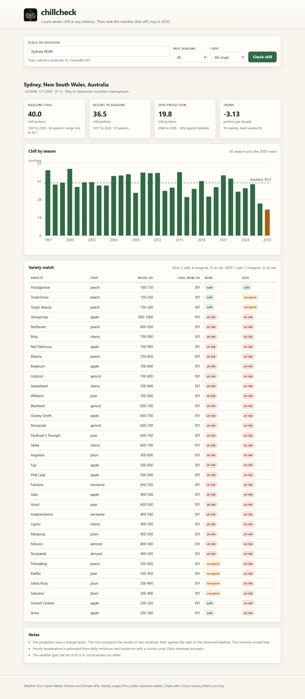
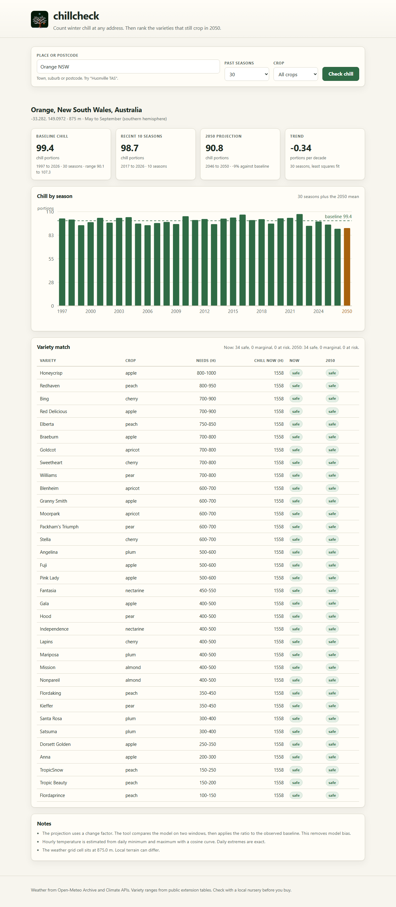

# chillcheck

Count winter chill at any address. Then rank the fruit varieties that still crop in 2050.


Deciduous fruit trees need a set number of cold hours each winter. This number is
the chill requirement of the variety. A warm winter gives a low chill total. The
tree then breaks dormancy late and unevenly. Fruit set and fruit size drop.

Most catalogues still assume the climate of 1980. chillcheck measures the real
winter at one address, then compares it with the requirement of each variety. It
repeats the test against a 2050 projection.

## Features

- **30 seasons of real weather.** Daily minimum and maximum temperature from the
  Open-Meteo Archive API, pinned to ERA5 so the record stays homogeneous.
- **Three chill metrics.** Chill hours (0 to 7.2 C), Utah units (Richardson
  weights), and chill portions (the Dynamic Model of Erez et al. 1990).
- **34 varieties across 8 crops.** Apple, pear, peach, nectarine, cherry, plum,
  apricot and almond, each with a requirement range and a source note.
- **A 2050 projection you can defend.** The tool applies a model change factor to
  the observed baseline. This removes the large local bias in raw GCM output.
- **One decision per variety.** Each variety gets a status of safe, marginal or
  at risk, now and in 2050.
- **Three ways in.** A web UI, a CLI, and a JSON API.

## Quick start

```bash
git clone https://github.com/fuleinist/chillcheck.git
cd chillcheck
python -m venv .venv
.venv\Scripts\activate          # Windows
pip install -e ".[server,dev]"
```

Run the CLI:

```bash
chillcheck --place "Orange NSW" --years 30
chillcheck --lat -33.78 --lon 151.12 --json
chillcheck --place "Huonville TAS" --crops apple,cherry
```

Run the web UI:

```bash
uvicorn chillcheck.api:app --port 8771
```

Open <http://127.0.0.1:8771>. Pass `?lat=-33.28&lon=149.10&place=Orange%20NSW` to
load a site directly.

Run the tests:

```bash
python -m pytest
```

## Screenshots

Sydney, 30 seasons. Five low-chill varieties clear their requirement now. None
clear it in 2050.



Orange, 30 seasons. A cold tableland site at 875 m. Every variety in the table
clears its requirement, now and in 2050.



## Measured results

Both runs use the default settings: 30 seasons and the 2050 horizon. The tool
read the archive on 10 November 2026.

| Site | Elevation | Chill portions | Chill hours | Trend per decade | 2050 portions |
| --- | --- | --- | --- | --- | --- |
| Sydney NSW | 87 m | 39.97 | 390.8 | -3.13 | 19.81 |
| Orange NSW | 875 m | 99.42 | 1557.5 | -0.34 | 90.85 |

Sydney loses about half its chill by 2050 under the default model set. Orange
loses about nine percent. The difference matters more than the absolute numbers.

## How it works

**Hourly temperature.** Daily minimum and maximum alone are not enough for a
chill model. The tool anchors the minimum at 05:00 and the maximum at 15:00, then
joins each pair with a cosine half wave. The daily extremes stay exact.

**Chill hours.** Count the hours at or between 0 C and 7.2 C. Nursery tables use
this unit, so it is the only unit that can be compared with a published
requirement.

**Utah units.** Sum the Richardson (1974) weights per hour. Above 15.9 C the
weights go negative, so a hot spell removes chill.

**Chill portions.** The Dynamic Model tracks an intermediate product across the
season. State carries from hour to hour. The code follows the published equations
and the reference implementation in the R package `chillR`.

**Variety match.** A variety is safe when the season total reaches the upper end
of its range, marginal when it reaches the lower end, and at risk below that.

**2050 projection.** Raw GCM output carries a large local bias. At Sydney the
default model set puts the winter minimum about 4 C above the reanalysis. The
tool therefore compares the model against itself on two windows, 1995 to 2004 and
2046 to 2050. It applies that ratio to the observed baseline. Hours follow from
the observed hours-per-portion ratio, because the model does not resolve the cold
tail.

## Data sources

- [Open-Meteo Archive API](https://open-meteo.com/en/docs/historical-weather-api) -
  daily minimum and maximum temperature, ERA5 reanalysis. Free, no key.
- [Open-Meteo Climate API](https://open-meteo.com/en/docs/climate-api) - CMIP6
  downscaled projections to 2050. Free, no key.
- [OpenStreetMap Nominatim](https://nominatim.openstreetmap.org/) - place name and
  postcode lookup. Free, one request per second.
- [Open-Meteo Geocoding API](https://open-meteo.com/en/docs/geocoding-api) -
  fallback place lookup.
- Variety chill ranges come from public extension tables (UC Davis, NSW DPI,
  University of Florida). Each entry carries its own source note in
  `chillcheck/data/varieties.json`.

## Limits

- A weather grid cell is not an orchard. The report shows the grid elevation so
  you can judge the gap.
- The cosine curve cannot show a warm night after a hot day.
- Variety tables disagree between sources. Ranges are wide on purpose.
- The 2050 figure is a planning signal, not a forecast.
- Chill hours understate chill at warm sites. The report shows both metrics and
  says when they diverge.
- Check with a local nursery before you buy. This tool does not sell trees.

## License

MIT. See [LICENSE](LICENSE).